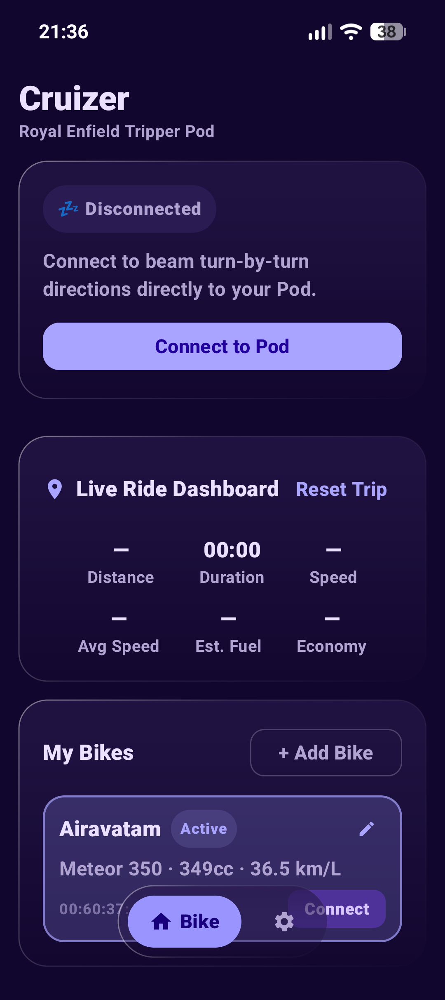
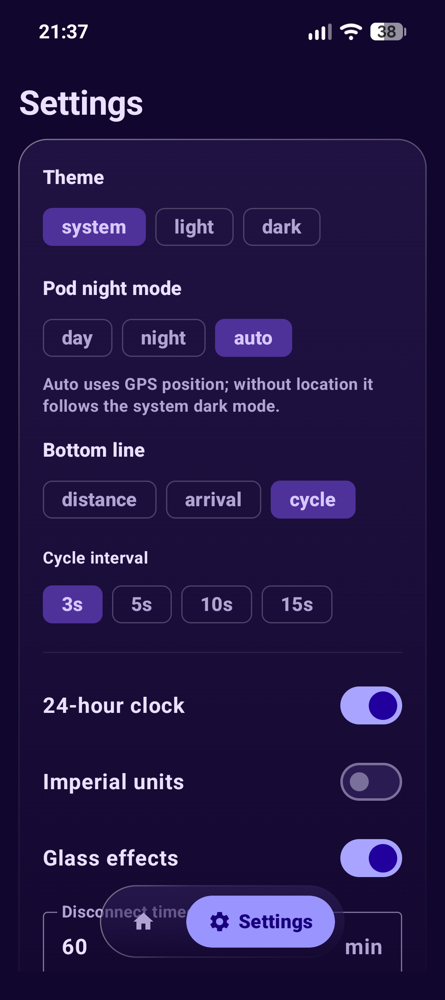

# Cruizer

<p align="center">
  
  &nbsp;&nbsp;
  
</p>

Cruizer is a free, open-source Android app that turns the little round
**Royal Enfield Tripper Pod** on your motorcycle's dial into a smart
turn-by-turn display — without needing Royal Enfield's own app, an account,
or an internet connection.

Your phone already knows where to turn: it's running a navigation app like
OsmAnd, Organic Maps, CoMaps, Google Maps or Waze. Cruizer simply takes those
directions and projects them onto the Pod's screen, exactly like the official
app does — but it works with the navigation app *you* already use.

## What you get

- **Turn arrows on your dial.** Left, right, slight, sharp, U-turn,
  roundabouts with the exit number — the Pod shows the same big arrows the
  official app draws.
- **Distances that make sense.** "In 250 m" counts down as you ride, and the
  bottom line can show how far the trip has left, your arrival time, or both
  cycling every few seconds.
- **Live ride stats.** Time, distance, current/average/max speed and an
  estimated fuel figure, right in the app (GPS-optional; the clock works even
  without location permission).
- **Multi-bike support.** Save a profile per bike (engine size, real-world
  economy) so fuel estimates match the machine you're riding.
- **Auto day/night.** The Pod's screen dims at night based on the sun's
  actual position, so it never blinds you after dark.

## How it works (the short version)

1. Turn the ignition on. The Pod starts advertising over Bluetooth for about
   30 seconds.
2. Press **Connect** in Cruizer. The Pod shows a 6-digit PIN — type it in
   once and the phone is remembered. After that, every ride reconnects by
   itself.
3. Start navigation in your favourite app. Cruizer reads its turn
   instructions (from the app's own navigation data where available, like
   CoMaps, or from its navigation notifications/screen otherwise) and beams
   them to the Pod once per second.

The app keeps the link alive with the same keep-alive heartbeat the official
app uses, so the Pod never drops it mid-ride. Nothing leaves your phone:
no cloud, no account, no tracking.

## Supported navigation apps

| App | How Cruizer reads turns |
|---|---|
| CoMaps | Structured data (best — exact maneuvers, exits, distances) |
| OsmAnd / Organic Maps / Google Maps / Waze | Navigation notifications, plus Google Maps' on-screen text |

Google Maps only updates its notification about once a minute, so Cruizer can
additionally read Maps' screen directly (you'll be asked to enable that in
Android's accessibility settings; the app shows a banner when it's worth it).

## Requirements

- An Android 12+ phone with Bluetooth.
- A Royal Enfield Tripper Pod (Meteor 350 etc.). The newer Tripper Dash
  cluster (Hunter 350 etc.) is a different device and is **not** supported
  yet.
- Optional: location permission for the ride distance/speed and the auto
  night mode.

## Installing

Grab an APK from [Releases](../../releases) and install it, or build it
yourself:

```sh
./gradlew app:assembleRelease   # APK at app/build/outputs/apk/release/
```

First launch walks you through the permissions (Bluetooth, notifications).
Then press **Connect**, turn the ignition on, and ride.

## Credits, AI notice, warranty

- The Bluetooth protocol was figured out independently from the hardware and
  cross-checked against the notes of
  [wazetripper](https://github.com/jnsdias/wazetripper) — see
  [NOTICE.md](NOTICE.md) and [docs/PROTOCOL.md](docs/PROTOCOL.md).
- **This code was written with substantial assistance from AI tools
  (LLM-based coding agents) and reviewed by a human.** Treat it accordingly:
  read what it does, not just what it claims.
- **No warranty, no liability.** This software is provided "as is", without
  warranty of any kind. It talks to a display on your motorcycle's
  instrument cluster — never interact with your phone while riding, and
  verify the Pod's behaviour while parked before trusting it in traffic.
  The authors are not liable for anything that happens to you, your bike,
  or your Pod while using this app. Use it at your own risk.
